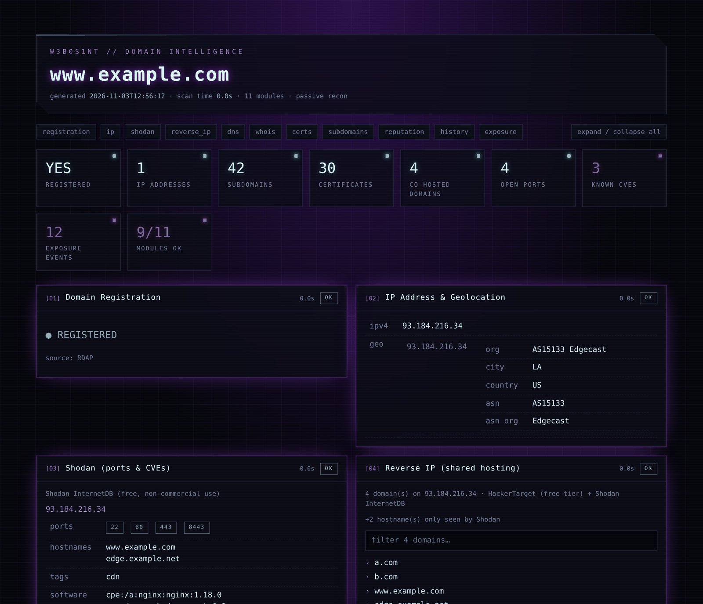

<div align="center">


# WebOSINT

**Passive domain intelligence from your terminal: one command, eleven sources, a few seconds.**


<a href="https://github.com/C3n7ral051nt4g3ncy/webosint/blob/master/LICENSE"></a>
<a href="https://internetdb.shodan.io/"></a>

<a href="https://github.com/C3n7ral051nt4g3ncy"></a>
<a href="https://ko-fi.com/tacticalintelanalyst"></a>
<a href="https://user-images.githubusercontent.com/104733166/171052611-1f76b07c-832f-4a4a-9a0a-2f94595c28c9.png"></a>

[Quick start](#-quick-start) · [Usage](#-usage) · [HTML report](#-html-report) · [Modules](#-modules) · [API keys](#-api-keys) · [Docker](#-docker) · [Troubleshooting](#-troubleshooting) · [Changelog](#-whats-new-in-v31)

</div>

---

## 🌐 What is WebOSINT?

WebOSINT is a Python tool for **passive reconnaissance on a domain**. Give it a domain (or a URL) and it collects registration, hosting, DNS, certificate, subdomain, reputation, WHOIS history and credential exposure data from public sources. It never touches the target's own servers beyond normal DNS resolution.

- ⚡ **Fast.** All modules run in parallel, so a full scan takes seconds.
- 🧭 **Simple.** Run it with no arguments for a guided menu, or script it from the command line.
- 🔑 **No key required to start.** Nine of the eleven modules are free, Shodan included. Modules whose key is missing are skipped, not fatal.
- 📄 **Report-ready.** Export a futuristic **HTML report**, **JSON** for your pipeline, or **Markdown** for your case notes.
- 📚 **Batch mode.** Feed it a list of domains.

---

## 🚀 Quick start

```bash
git clone https://github.com/C3n7ral051nt4g3ncy/webosint
cd webosint
python3 -m venv .venv && source .venv/bin/activate   # recommended
pip install -r requirements.txt

python3 webosint.py example.com
```

> [!TIP]
> Run `python3 webosint.py` without arguments for **interactive mode**: type a domain, then press Enter to run every module, or type the numbers of the ones you want (`2,4,7`).

---

## 🛠️ Usage

```bash
python3 webosint.py example.com                          # every module
python3 webosint.py https://www.example.com/page         # URLs are cleaned automatically
python3 webosint.py example.com -m dns,whois,subdomains  # only these (names or numbers: -m 4,5,7)
python3 webosint.py example.com -x reverse_ip,history    # everything except these
python3 webosint.py example.com --html --open             # HTML report, opened in your browser
python3 webosint.py example.com -o result.json --md report.md
python3 webosint.py -f domains.txt -o results.json       # batch, one domain per line
python3 webosint.py --list                               # show modules
```

Pipe the results into other tools with `--json`:

```bash
python3 webosint.py example.com -m subdomains --json | jq -r '.modules.subdomains.data.subdomains[]'
```

<details>
<summary><b>All options</b></summary>

| Option | Description |
|---|---|
| `domains` | One or more domains or URLs |
| `-f`, `--file` | Read domains from a file (one per line, `#` for comments) |
| `-m`, `--modules` | Modules to run: comma list of names or numbers |
| `-x`, `--exclude` | Modules to skip |
| `-o`, `--output` | Save results as JSON |
| `--html [FILE]` | Save a self-contained HTML report (default name `webosint_<domain>_<date>.html`) |
| `--open` | Open the HTML report in your browser when the scan ends |
| `--md` | Save results as a Markdown report |
| `--json` | Print raw JSON to stdout (no banner, no colours) |
| `--full` | Don't truncate long lists (reverse IP, subdomains) in the terminal |
| `-t`, `--timeout` | Per-request timeout in seconds (default `20`) |
| `-w`, `--workers` | Number of parallel workers (default `10`) |
| `--config` | Path to an alternative `config.json` |
| `--no-banner`, `--no-color` | Quieter output (`NO_COLOR` is also respected) |
| `-v`, `--version` | Show version |

</details>

<details>
<summary><b>Example output</b></summary>

```text
▶ Target: example.com  (11 modules in parallel)
  ✔ Domain Registration              0.6s
  ✔ DNS Records                      0.3s
  ✔ IP Address & Geolocation         0.9s
  ✔ Shodan (ports & CVEs)            0.7s
  ✔ Reverse IP (shared hosting)      1.2s
  ✔ WHOIS / RDAP                     0.6s
  ✔ Credential Exposure              2.1s
  ✔ SSL Certificates                 6.4s
  ✔ Subdomains                       6.4s
  – Domain Reputation                0.0s
  – WHOIS History                    0.0s

■ Subdomains
    37 unique name(s) — crt.sh (Certificate Transparency)
    api.example.com
    mail.example.com
    ...

■ Domain Reputation
    skipped: no WhoisXML API key (config.json or $WEBOSINT_WHOISXML_KEY)
```
✔ = worked · – = skipped (missing key) · ✘ = failed (reason shown in the report)

</details>

---

## 🖥️ HTML report

```bash
python3 webosint.py example.com --html --open
python3 webosint.py -f domains.txt --html case_42.html     # several domains in one report
```

A single self-contained file (no internet or external fonts needed), easy to attach to a case file or share with a client:

- **Summary tiles:** registration, IPs, subdomains, certificates, co-hosted domains, exposure events, reputation
- **One card per module** with status, timing and results; fold/unfold each card or all at once
- **Live filter** on long lists (subdomains, reverse IP)
- **Clickable** crt.sh certificate links
- **Responsive** (works on a phone) and **print-friendly**
- All collected data is **HTML-escaped**, so a malicious DNS record or WHOIS field can't run code in your browser

In interactive mode, WebOSINT asks *"Save an HTML report?"* at the end. Press Enter and it opens in your browser.

<div align="center"></div>

---

##  Shodan, built in

Every scan queries **[Shodan InternetDB](https://internetdb.shodan.io/)** for each IP of the domain. It's **free, needs no account or API key**, and is updated weekly:

| What you get | Why it matters |
|---|---|
| **Open ports** | 22 (SSH), 3389 (RDP), 3306/5432 (databases), 8080/8443 (admin panels) reveal the real attack surface behind a website |
| **Software (CPE)** | Exact products and versions, e.g. `nginx 1.18.0`, `OpenSSH 8.2` |
| **Known CVEs** | Vulnerabilities Shodan associates with those versions, linked to NVD in the HTML report |
| **Tags** | `cdn`, `cloud`, `vpn`, `self-signed`, `honeypot`, … for quick context on the infrastructure |
| **Hostnames** | Names seen on the IP: also used as **backup and enrichment for reverse IP** |

> [!NOTE]
> InternetDB is free for **non-commercial use**. Commercial use requires a Shodan enterprise licence. CVEs are inferred from software versions: confirm them before drawing conclusions.

---

## 🧩 Modules

| # | Module | What it reveals for the investigation | Source | Key |
|:-:|---|---|---|:-:|
| 1 | `registration` | Whether the domain is registered (available, parked, or recently dropped domains) | RDAP · WHOIS | — |
| 2 | `ip` | IPv4/IPv6, hosting provider, ASN, geolocation, cross-checked by two services | DNS · ipinfo.io · ipapi.co | — |
| 3 |  `shodan` | Open ports, detected software (CPE), tags (cdn, cloud, vpn, self-signed…) and **known CVEs** for each IP; exposed admin/SSH/DB ports often matter more than the website | [Shodan InternetDB](https://internetdb.shodan.io/) | — |
| 4 | `reverse_ip` | Other domains on the same IP: shared hosting, sister sites, related infrastructure. HackerTarget results **plus** hostnames Shodan saw on that IP; Shodan takes over automatically when HackerTarget's free quota runs out | HackerTarget · Shodan | optional |
| 5 | `dns` | A, AAAA, CNAME, MX (mail provider), NS, TXT (SPF, site verifications for Google/Microsoft/etc.), SOA, CAA, DMARC | local resolver (dnspython) | — |
| 6 | `whois` | Registrar (+ IANA ID), creation/expiry/update dates, status, name servers, DNSSEC, registrant/abuse contacts when not redacted | RDAP · WHOIS fallback | — |
| 7 | `certs` | Number of certificates, first-seen date (a good proxy for when the site went live), issuers, latest certs | crt.sh | — |
| 8 | `subdomains` | Every hostname that has appeared in a certificate: dev/staging hosts, VPNs, admin panels, forgotten services | crt.sh | — |
| 9 | `reputation` | Reputation score plus failed security tests (malware, SSL, mail config) | WhoisXML | required |
| 10 | `history` | Past registrars and registrant details over time, often revealing the owner before privacy protection was turned on | WhoisFreaks | required |
| 11 | `exposure` | Infostealer and data-breach exposure linked to the domain over the last 12 months (employee vs client events, first/last seen) | [Lunar Domain Exposure API](https://docs.webz.io/docs/webz/domain-exposure-api) | — |

> [!NOTE]
> crt.sh is fetched **once** and shared between `certs` and `subdomains`, with automatic retries. It is a free community service and is often overloaded; if it fails, run `-m certs,subdomains` again a minute later.

---

## 🔑 API keys

Keys are **optional**. Put them in `config.json` **or** export them as environment variables (handy for Docker or CI).

`config.json` is **your private file**: it is git-ignored and Docker-ignored, so your keys never get pushed or baked into an image. The repo only ships the template `config.example.json`, and WebOSINT creates `config.json` from it on first run (or do it yourself: `cp config.example.json config.json`).

```json
{
  "WHOIS_XML_API_KEY": "your-key",
  "HACKERTARGET_API_KEY": "your-key",
  "WHOIS_FREAKS_API_KEY": "your-key"
}
```

| Service | Free tier | `config.json` | Environment variable | Unlocks |
|---|---|---|---|---|
| [WhoisXML](https://whois.whoisxmlapi.com) | 500 requests | `WHOIS_XML_API_KEY` | `WEBOSINT_WHOISXML_KEY` | `reputation` |
| [WhoisFreaks](https://whoisfreaks.com) | 100 requests | `WHOIS_FREAKS_API_KEY` | `WEBOSINT_WHOISFREAKS_KEY` | `history` |
| [HackerTarget](https://hackertarget.com/scan-membership/) | 20 lookups/day, 50 results each (no key) | `HACKERTARGET_API_KEY` | `WEBOSINT_HACKERTARGET_KEY` | more `reverse_ip` results (paid membership) |

```bash
WEBOSINT_WHOISXML_KEY=xxxx WEBOSINT_WHOISFREAKS_KEY=yyyy python3 webosint.py example.com
```

> [!WARNING]
> Never put real keys in `config.example.json`, because that file **is** committed.

---

## 🐳 Docker

```bash
docker build -t webosint .
docker run --rm -it webosint example.com
docker run --rm -it -e WEBOSINT_WHOISXML_KEY=xxxx webosint example.com -m reputation
docker run --rm -v "$PWD:/out" webosint example.com -o /out/result.json
```

---

## 🩺 Troubleshooting

<details>
<summary><b>WHOIS fails for a domain that exists</b></summary>

Since v3.1, WebOSINT asks the registry's **RDAP** server first (found through IANA's bootstrap list, cached in `~/.cache/webosint/`). If a TLD has neither RDAP nor a WHOIS server python-whois knows, the error message shows what each source answered.
</details>

<details>
<summary><b>Registered domains show as "not registered", or WHOIS is skipped</b></summary>

You probably have both the `whois` and `python-whois` packages installed, and they conflict. WebOSINT detects this and tells you. Fix it with a clean install, ideally in a virtualenv:

```bash
pip3 uninstall -y whois python-whois
pip3 install python-whois
```
</details>

<details>
<summary><b>Certificates / Subdomains fail with a network or non-JSON error</b></summary>

crt.sh is overloaded. Wait a minute and run `python3 webosint.py example.com -m certs,subdomains`. You can also raise the timeout with `-t 60`.
</details>

<details>
<summary><b>Credential Exposure says "still generating the report"</b></summary>

Lunar builds the report on demand the first time a domain is requested. WebOSINT waits up to 90 seconds; if it's still not ready, run `python3 webosint.py example.com -m exposure` again a minute later.
</details>

<details>
<summary><b>Reverse IP says "API count exceeded"</b></summary>

You've used up HackerTarget's 20 free daily lookups. Nothing to do: WebOSINT automatically uses the hostnames Shodan has seen on that IP as a backup. For full reverse IP lists, wait until tomorrow or add a HackerTarget key.
</details>

<details>
<summary><b>Long lists are cut off in the terminal</b></summary>

Use `--full`, or export with `-o result.json` / `--md report.md`. Exports always contain the complete lists.
</details>

---

## ✨ What's new in v3.1

-  **Shodan InternetDB (free, no key).** New `shodan` module on every scan: open ports, software, tags and known CVEs per IP (CVE links to NVD in the HTML report, new *Open ports* / *Known CVEs* tiles). Shodan also backs up and enriches reverse IP, so results keep coming when HackerTarget's free quota is used up.
- 🧾 **RDAP support.** WHOIS and registration checks now query **RDAP** first (the structured JSON successor of WHOIS, mandatory for every gTLD) and fall back to classic WHOIS. New gTLDs such as `.sarl`, `.app`, `.xyz` or `.paris`, which python-whois can't read, now return full results.
- 🔐 **API keys stay private.** `config.json` is no longer tracked by git (template: `config.example.json`) and is excluded from Docker builds.
- 🎯 **No more false "not registered".** If no registry answers, WebOSINT says so (or confirms registration from DNS) instead of guessing.

## ✨ What's new in v3.0

- ⚡ **Parallel engine.** All modules run at the same time, with no more forced pauses or y/n prompts between modules.
- 🖥️ **Real CLI.** Module selection (`-m` / `-x`), batch mode (`-f`), JSON/Markdown export, `--json` for piping.
- 🛰️ **HTML report** (`--html`): self-contained, dark futuristic dashboard with summary tiles, filters, foldable cards; also offered at the end of interactive mode.
- 🧭 **Interactive menu** when run without arguments.
- 🔑 **Keys from config.json or environment variables.** Missing keys skip a module instead of breaking the run.
- 🧬 **DNS via the local resolver** (dnspython): faster, no rate limit, adds CAA and DMARC.
- 🕵️ **New `exposure` module** using the free Lunar Domain Exposure API ([#5](https://github.com/C3n7ral051nt4g3ncy/WebOSINT/issues/5)). WebOSINT waits automatically while Lunar generates the report (up to 90 s).
- 🧹 **Cleaner results.** De-duplicated subdomains (no wildcards or multi-line entries), readable certificate and WHOIS history summaries.
- 🐞 **Fixes.** "Wrong key" exits on valid answers, WHOIS crash, ipinfo crash on missing fields, duplicate crt.sh/WHOIS requests, automatic retries on 429/5xx.
- 🐳 **Docker** now takes arguments: `docker run --rm -it webosint example.com`.

---

## 🤝 Contributing

Ideas, bug reports and PRs are welcome. Open an [issue](https://github.com/C3n7ral051nt4g3ncy/WebOSINT/issues) or start a thread in the [discussions](https://github.com/C3n7ral051nt4g3ncy/webosint/discussions).

Adding a module is simple. Write a function `mod_xxx(ctx)` that returns a dict, then register it in the `MODULES` list in `webosint.py`. The shared `ctx` gives you an HTTP session with retries, plus cached WHOIS, IP and crt.sh lookups.

---

## ⚠️ Disclaimer

This tool is for the OSINT and cyber community. Don't use it for wrong, immoral, or illegal purposes. Respect the terms of service of the APIs it relies on.

---

## 🙏 Credits

- [Hacker Target](https://hackertarget.com), [WhoisXML](https://main.whoisxmlapi.com), [WhoisFreaks](https://whoisfreaks.com), [crt.sh](https://crt.sh), [ipinfo.io](https://ipinfo.io), [ipapi.co](https://ipapi.co), [Shodan](https://www.shodan.io) (InternetDB) and [Lunar / Webz.io](https://docs.webz.io/docs/webz/domain-exposure-api) for their APIs and free tiers
- [@cipher387](https://github.com/cipher387) / [@cyb_detective](https://twitter.com/cyb_detective) and [Euler Neto](https://github.com/netoeuler) for testing the first release
- [@scorpix06](https://github.com/scorpix06) for the original Docker support
- Shodan icon from [selfh.st/icons](https://selfh.st/icons/) (CC BY 4.0). Shodan is a trademark of its owner; WebOSINT is not affiliated with Shodan

<br>

<div align="center">

### 💜 Support

If WebOSINT saves you time, consider supporting the work via **[Ko-fi](https://ko-fi.com/tacticalintelanalyst)** or **[Bitcoin](https://user-images.githubusercontent.com/104733166/171052611-1f76b07c-832f-4a4a-9a0a-2f94595c28c9.png)**.


Made by **[@C3n7ral051nt4g3ncy](https://github.com/C3n7ral051nt4g3ncy)** · [@OSINT_Tactical](https://x.com/OSINT_Tactical) · Licensed under [MIT](LICENSE)

</div>
